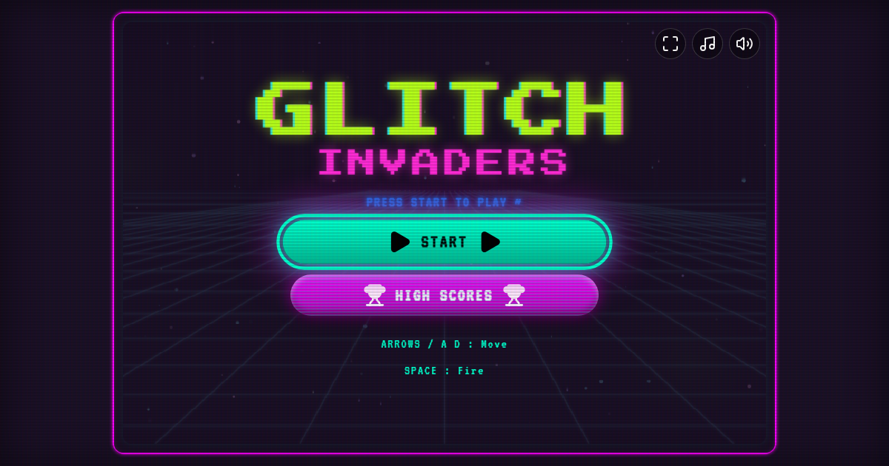
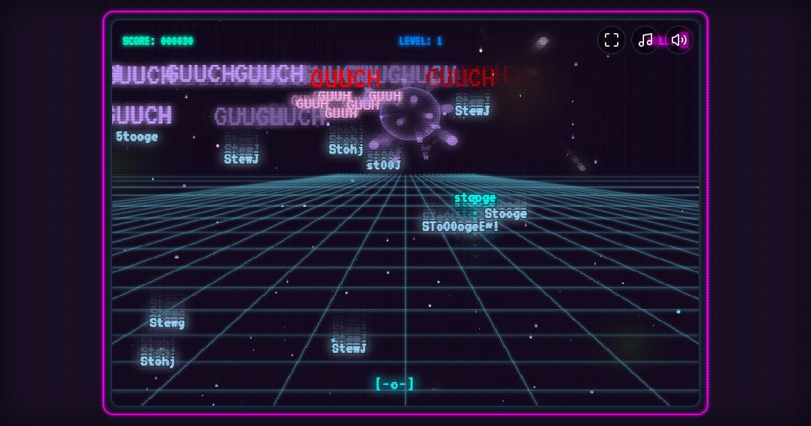

<h1 align="center">GLITCH INVADERS</h1>

<p align="center">
  A glitchy synthwave arcade shooter that runs in your browser.<br />
  Boss fights, elite enemies, power-ups and endless swarms.
</p>

<p align="center">
  <a href="https://glitch-invaders.chimske.workers.dev"><b>Play it now</b></a>
</p>

<p align="center">
  
  
</p>

## Game modes

| Mode | What it is |
|---|---|
| **Classic Protocol** | The original arcade run. |
| **Retro Breach** | A recreation of the classic invaders formation, with matrix glitch faces. |
| **Survival Override** | Endless swarm. Survive as long as your hull holds. |
| **Cyber Warfare** | Fight through glitch cyber-swarms across corrupted sectors, with boss battles. |

## Features

- Boss fights with several boss types that scale with difficulty, and infinite progression
- Elite enemies (Golden, Corrupted, Overclocked) and a swarm director that mixes enemy types
- Power-ups dropped by enemies: Spread, Rapid and Pierce, and they stack
- Random events (storms, power surges, clustered foes)
- Scanline and CRT look, neon particles, synthwave grid, 3D post-processing (bloom)
- Dynamic music with separate music and sound mute, pause menu, high scores (stored in your browser)
- Works with keyboard and with an on-screen D-pad on touch screens; fullscreen button

## Controls

| Action | Keys |
|---|---|
| Move | `A` / `D` or `Left` / `Right` |
| Shoot | `Space`, `W` or `Up` |
| Pause | `Esc` |

## Play online

https://glitch-invaders.chimske.workers.dev (no install, works on desktop and touch screens).

## Run it locally

Needs Node 22+.

```bash
npm install
npm run dev      # http://localhost:3000
npm run build    # production build in dist/
npm run lint     # typecheck
```

## Tech

React 19, TypeScript, Three.js with React Three Fiber (post-processing), Tailwind CSS, Zustand and Vite.

## Licence

Code: [MIT](LICENSE).
The music in `public/audio/` is the author's own work and is **not** covered by the MIT licence. See [`public/audio/NOTICE.md`](public/audio/NOTICE.md).
